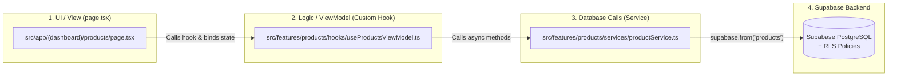

# Katha Management v2.0 — Web & Multi-Panel Architecture Guide
*(For a Flutter MVVM Developer Transitioning to Next.js + React + Supabase)*

Welcome to the web side of **Katha Management v2.0**! Because you already understand **Flutter's MVVM + Repository pattern**, you already know 85% of how our Next.js (React) web applications work. The concepts are identical—only the file names and syntax change.

---

## 1. Mental Model: Flutter MVVM vs. Next.js (React)

Use this cheat sheet whenever you are wondering *"What is the React/Next.js equivalent of what I do in Flutter?"*

| Concept | Flutter (`lib/` - Distributor App) | Next.js / React (`company-web/` & `admin-web/`) |
| :--- | :--- | :--- |
| **Entry Point** | `lib/main.dart` (`runApp(MyApp())`) | `src/app/layout.tsx` (Root shell) & `src/app/page.tsx` (`/` home route) |
| **Routing / Navigation** | `lib/core/routes/routes_generator.dart` (`switch (settings.name)`) | **Folder-based Routing** inside `src/app/` (every folder with a `page.tsx` is automatically a URL route!) |
| **Screen / View** | `OrdersView extends StatelessWidget` (`orders_view.dart`) | `export default function OrdersPage()` (`src/app/(dashboard)/orders/page.tsx`) |
| **Reusable Widget** | `GlassCard extends StatelessWidget` | `export function Card({ children })` (`src/components/ui/Card.tsx`) |
| **ViewModel (Logic & State)** | `OrderViewModel extends ChangeNotifier` (`notifyListeners()`) | **Custom React Hook**: `useOrdersViewModel()` using `useState()` & `useEffect()` (`src/features/orders/hooks/useOrdersViewModel.ts`) |
| **Data Model / DTO** | `ProductModel` (`lib/core/models/product/product_model.dart`) | **TypeScript Interface**: `export interface Product` (`supabase/types/database.types.ts`) |
| **Repository (DB Calls)** | `SqfliteProductRepository implements ProductRepository` | **Service Module**: `productService.ts` calling Supabase (`src/features/products/services/productService.ts`) |
| **Dependency Injection / State Sharing** | `MultiProvider` / `ChangeNotifierProvider` / `context.watch<T>()` | **React Context Provider** (`createContext` / `useContext`) or calling your Custom Hook directly inside the Page |
| **Styling** | `BoxDecoration`, `EdgeInsets.all(16)`, `TextStyle(...)` | **Tailwind CSS utility classes**: `className="p-4 rounded-xl bg-white shadow-sm text-lg font-bold"` |
| **Dependencies File** | `pubspec.yaml` (`flutter pub get`) | `package.json` (`npm install`) |

---

## 2. Complete Project Folder Structure

Here is how our entire repository is organized so all **3 panels** remain cleanly separated while sharing the same Supabase database schema and TypeScript models:

```text
katha_management/
│
├── lib/                                      # 📱 PANEL 1: DISTRIBUTOR MOBILE APP (Flutter MVVM)
│   ├── main.dart                             # App entry & Provider registration
│   ├── core/
│   │   ├── database/app_database.dart        # Local SQLite DB (Free tier + Offline cache)
│   │   ├── sync/powersync_client_service.dart# PowerSync engine (syncs SQLite <-> Supabase)
│   │   ├── models/                           # Dart data classes (PartyModel, NewOrderModel, etc.)
│   │   ├── routes/routes_generator.dart      # Named route switchboard
│   │   └── services/                         # PartyBalanceService, PDF generator
│   ├── features/                             # Repository Layer (Data access)
│   │   ├── order/data/repositories/
│   │   ├── party/data/repositories/
│   │   ├── payment/data/repositories/
│   │   └── product/data/repositories/
│   └── ui/
│       ├── distributer/                      # Distributor-specific Views & ViewModels
│       │   ├── auth/                         # Login & 12-char Invite Token claim screen
│       │   ├── dashboard/                    # DashboardView + DashboardViewModel
│       │   ├── customers/                    # CustomersView + CustomersViewModel
│       │   ├── orders/                       # OrdersView + OrderViewModel
│       │   ├── party_history/                # PartyHistoryView + PartyHistoryViewModel
│       │   ├── navigation_bar/               # Bottom navigation bar
│       │   └── settings_view/                # SettingsView + SettingsViewModel
│       └── features/                         # Shared forms (add_party, add_payment, new_order)
│
├── company-web/                              # 💻 PANEL 2: COMPANY ADMIN WEBSITE (Next.js - Port 3000)
│   ├── package.json                          # Equivalent to pubspec.yaml for Company Web
│   ├── .env.local                            # Secret keys (Supabase URL & Anon Key)
│   └── src/
│       ├── app/                              # 🧭 NAVIGATION & VIEWS (URL Routes)
│       │   ├── layout.tsx                    # Global wrapper (like MaterialApp builder)
│       │   ├── page.tsx                      # Route: "/" (Company Home Dashboard)
│       │   ├── (auth)/                       # Route group (parentheses don't affect URL!)
│       │   │   └── login/page.tsx            # Route: "/login"
│       │   └── (dashboard)/                  # Route group for logged-in Company screens
│       │       ├── products/page.tsx         # Route: "/products"
│       │       ├── distributors/page.tsx     # Route: "/distributors" (Invite tokens & stats)
│       │       ├── territories/page.tsx      # Route: "/territories"
│       │       ├── orders/page.tsx           # Route: "/orders"
│       │       ├── parties/page.tsx          # Route: "/parties"
│       │       └── settings/page.tsx         # Route: "/settings"
│       ├── features/                         # 🧠 VIEWMODELS (Hooks) & REPOSITORIES (Services)
│       │   └── products/
│       │       ├── hooks/useProductsViewModel.ts    # <-- VIEWMODEL (State & UI Logic)
│       │       ├── services/productService.ts       # <-- REPOSITORY (Supabase DB Queries)
│       │       └── components/ProductFormModal.tsx  # <-- Feature-specific Widgets
│       ├── components/                       # 🧩 SHARED REUSABLE WIDGETS (Buttons, Tables, Navbar)
│       └── lib/
│           └── supabase/
│               ├── client.ts                 # Supabase client for Browser ("use client")
│               └── server.ts                 # Supabase client for Server Components
│
├── admin-web/                                # 🛡️ PANEL 3: SUPER ADMIN WEBSITE (Next.js - Port 3001)
│   ├── package.json                          # Equivalent to pubspec.yaml for Super Admin Web
│   └── src/
│       ├── app/                              # 🧭 NAVIGATION & VIEWS (URL Routes)
│       │   ├── layout.tsx                    # Root layout
│       │   ├── page.tsx                      # Route: "/" (Super Admin Control Plane)
│       │   ├── (auth)/login/page.tsx         # Route: "/login"
│       │   └── (dashboard)/
│       │       ├── companies/page.tsx        # Route: "/companies" (Provision Company Tenants)
│       │       ├── subscriptions/page.tsx    # Route: "/subscriptions" (Free/Premium plans)
│       │       ├── users/page.tsx            # Route: "/users" (Global RBAC directory)
│       │       ├── analytics/page.tsx        # Route: "/analytics"
│       │       └── audit-logs/page.tsx       # Route: "/audit-logs"
│       ├── features/                         # 🧠 VIEWMODELS (Hooks) & REPOSITORIES (Services)
│       │   └── companies/
│       │       ├── hooks/useCompaniesViewModel.ts   # <-- VIEWMODEL
│       │       └── services/companyTenantService.ts # <-- REPOSITORY
│       └── lib/supabase/                     # Supabase Browser & Server clients
│
└── supabase/                                 # 🗄️ SHARED BACKEND (Database, Sync & Edge Functions)
    ├── migrations/
    │   └── 00001_initial_multitenant_schema.sql # PostgreSQL Tables & Row-Level Security (RLS)
    ├── powersync/
    │   └── sync_rules.yaml                   # Rules controlling what syncs to Flutter SQLite
    ├── functions/
    │   ├── provision-company-tenant/index.ts # Server API: Super Admin creates a Company
    │   └── claim-invite-token/index.ts       # Server API: Distributor claims 12-char token
    └── types/
        └── database.types.ts                 # Shared Models (used by both Web Panels!)
```

---

## 3. Exactly Which Files Handle What in Next.js (Step-by-Step)

When building a feature in `company-web` or `admin-web` (for example, **Managing Products** in the Company Panel), you only touch **4 types of files**, just like in Flutter MVVM:



---

### A. Handling Database Calls (The Repository Layer)
* **Where it lives**: `src/features/<feature_name>/services/<feature>Service.ts`
* **Flutter Equivalent**: `lib/features/product/data/repositories/sqflite_product_repository.dart`
* **Rule**: Never write raw `supabase.from(...)` queries inside your UI files. Put all database queries inside a `*Service.ts` file.

**Example (`company-web/src/features/products/services/productService.ts`)**:
```typescript
import { createClient } from "@/lib/supabase/client";

export interface CreateProductInput {
  company_id: string;
  name: string;
  sku: string;
  base_unit: string;
  base_price: number;
}

export const productService = {
  // SELECT * FROM products WHERE company_id = '...'
  async getCompanyProducts(companyId: string) {
    const supabase = createClient();
    const { data, error } = await supabase
      .from("products")
      .select("*, product_sizes(*)")
      .eq("company_id", companyId)
      .order("created_at", { ascending: false });

    if (error) throw new Error(error.message);
    return data ?? [];
  },

  // INSERT INTO products (...) VALUES (...)
  async createProduct(input: CreateProductInput) {
    const supabase = createClient();
    const { data, error } = await supabase
      .from("products")
      .insert(input)
      .select()
      .single();

    if (error) throw new Error(error.message);
    return data;
  },
};
```

---

### B. Handling Business Logic & State (The ViewModel Layer)
* **Where it lives**: `src/features/<feature_name>/hooks/use<Feature>ViewModel.ts`
* **Flutter Equivalent**: `ProductListViewModel extends ChangeNotifier`
* **How it works in React**:
  * In Flutter, you change a variable and call `notifyListeners()`, which rebuilds `Consumer<ViewModel>`.
  * In React, you use `const [products, setProducts] = useState([])`. Whenever you call `setProducts(newData)`, React **automatically calls `notifyListeners()` for you** and rebuilds the UI!
  * Any file that uses `useState` or `useEffect` must have `"use client";` on **Line 1**.

**Example (`company-web/src/features/products/hooks/useProductsViewModel.ts`)**:
```typescript
"use client";

import { useState, useCallback } from "react";
import { productService, CreateProductInput } from "../services/productService";

export function useProductsViewModel(companyId: string) {
  // 1. State variables (Just like fields in a Flutter ChangeNotifier)
  const [products, setProducts] = useState<any[]>([]);
  const [isLoading, setIsLoading] = useState<boolean>(false);
  const [errorMessage, setErrorMessage] = useState<string | null>(null);

  // 2. Action method (Just like Future<void> loadProducts() in Flutter)
  const loadProducts = useCallback(async () => {
    setIsLoading(true); // <-- Automatically triggers UI rebuild (like notifyListeners)
    setErrorMessage(null);
    try {
      const data = await productService.getCompanyProducts(companyId);
      setProducts(data); // <-- Updates list & rebuilds UI
    } catch (err: any) {
      setErrorMessage(err.message ?? "Failed to load products");
    } finally {
      setIsLoading(false);
    }
  }, [companyId]);

  const addProduct = useCallback(
    async (input: Omit<CreateProductInput, "company_id">) => {
      setIsLoading(true);
      try {
        await productService.createProduct({ ...input, company_id: companyId });
        await loadProducts(); // Refresh list
        return true;
      } catch (err: any) {
        setErrorMessage(err.message);
        return false;
      } finally {
        setIsLoading(false);
      }
    },
    [companyId, loadProducts]
  );

  // 3. Expose state and methods to the View
  return {
    products,
    isLoading,
    errorMessage,
    loadProducts,
    addProduct,
  };
}
```

---

### C. Handling UI / Screens (The View Layer)
* **Where it lives**: `src/app/(dashboard)/<route_name>/page.tsx` (for full screens) or `src/features/<feature>/components/*.tsx` (for smaller widgets/dialogs).
* **Flutter Equivalent**: `ProductListView extends StatefulWidget`
* **How `initState()` works in React**:
  * In Flutter, you call `viewModel.loadProducts()` inside `initState()`.
  * In React, you use `useEffect(() => { loadProducts(); }, [loadProducts]);` — this runs once when the screen mounts, just like `initState()`!

**Example (`company-web/src/app/(dashboard)/products/page.tsx`)**:
```tsx
"use client";

import { useEffect, useState } from "react";
import { useProductsViewModel } from "@/features/products/hooks/useProductsViewModel";

export default function CompanyProductsPage() {
  // 1. Connect the ViewModel (like context.watch<ProductViewModel>() in Flutter)
  const demoCompanyId = "00000000-0000-0000-0000-000000000001";
  const { products, isLoading, errorMessage, loadProducts, addProduct } =
    useProductsViewModel(demoCompanyId);

  // Local text controller state (like TextEditingController in Flutter)
  const [name, setName] = useState("");
  const [sku, setSku] = useState("");
  const [price, setPrice] = useState("");

  // 2. Equivalent to Flutter's initState()
  useEffect(() => {
    loadProducts();
  }, [loadProducts]);

  // 3. Equivalent to Flutter's Widget build(BuildContext context)
  return (
    <div className="p-8 max-w-6xl mx-auto">
      <h1 className="text-2xl font-bold">Master Product Catalog</h1>

      {/* Error Banner */}
      {errorMessage && (
        <div className="mt-4 p-3 bg-red-50 text-red-700 rounded-lg">
          {errorMessage}
        </div>
      )}

      {/* Loading Spinner (like isLoading ? CircularProgressIndicator() : ListView) */}
      {isLoading ? (
        <p className="mt-6 text-slate-500">Loading products...</p>
      ) : (
        <ul className="mt-6 space-y-3">
          {products.map((item) => (
            <li key={item.id} className="p-4 bg-white rounded-lg border">
              <span className="font-semibold">{item.name}</span> — Rs. {item.base_price}
            </li>
          ))}
        </ul>
      )}
    </div>
  );
}
```

---

### D. Handling Navigation & Routing
In Flutter, you register routes in `lib/core/routes/routes_generator.dart` and navigate using `Navigator.pushNamed(context, '/orders')`.

In **Next.js App Router**, **you never have to write a `routes_generator` file!** The folder structure inside `src/app/` **IS** your router:

1. **How URLs map to files**:
   * `src/app/page.tsx` $\rightarrow$ `http://localhost:3000/`
   * `src/app/(auth)/login/page.tsx` $\rightarrow$ `http://localhost:3000/login`
   * `src/app/(dashboard)/orders/page.tsx` $\rightarrow$ `http://localhost:3000/orders`
   * `src/app/(dashboard)/orders/[orderId]/page.tsx` $\rightarrow$ `http://localhost:3000/orders/123` (Dynamic route parameter, like passing `settings.arguments` in Flutter!)
   * *(Note: Folders wrapped in parentheses like `(dashboard)` or `(auth)` are **Route Groups**. They organize your files neatly without adding `(dashboard)` to the browser URL.)*

2. **Two Ways to Navigate Between Pages**:
   * **Way 1: Clicking a Button/Card in UI (`<Link>` widget)**
     ```tsx
     import Link from "next/link";

     // Equivalent to InkWell / TextButton calling Navigator.pushNamed(context, '/orders')
     <Link href="/orders" className="px-4 py-2 bg-blue-600 text-white rounded">
       Go to Orders
     </Link>
     ```
   * **Way 2: Navigating inside Logic / after a Form Submit (`useRouter` hook)**
     ```tsx
     "use client";
     import { useRouter } from "next/navigation";

     export default function LoginPage() {
       const router = useRouter();

       async function handleLoginSuccess() {
         // Equivalent to Navigator.pushReplacementNamed(context, '/orders')
         router.push("/orders");
       }
     }
     ```

3. **Persistent Sidebars & Top Navbars (`layout.tsx`)**:
   * In Flutter, you used `NavigationBarView` (`lib/ui/distributer/navigation_bar/navigattion_bar_view.dart`) to keep the bottom bar fixed while switching tabs.
   * In Next.js, if you create `src/app/(dashboard)/layout.tsx`, it wraps every page inside `(dashboard)/*` with a persistent Sidebar and Top Header automatically!

---

## 4. Important Next.js Concept: Server vs. Client Components

In Next.js 15, components run on the **Server** by default for fast initial page loads, unless you put `"use client"` at the top of the file.

Use this simple rule of thumb:
* **Add `"use client";` at the very top of the file** whenever the file needs:
  * State (`useState`)
  * Lifecycle (`useEffect`)
  * Button click handlers (`onClick={() => ...}`)
  * Text inputs (`onChange={(e) => ...}`)
  * Your custom ViewModel hooks (`useProductsViewModel`)
* **Leave out `"use client"`** only for simple static layouts or server-only pages.

---

## 5. Step-by-Step Checklist: How to Add Any New Feature

Whenever you want to build a new screen (e.g., **Invite Token Generator** in `company-web`), follow this exact 4-step recipe:

1. **Step 1 — Check/Add the Model (`supabase/types/database.types.ts`)**:
   Ensure the TypeScript `interface` (e.g., `InviteToken`) matches your Supabase table columns.
2. **Step 2 — Write the Database Queries (`src/features/distributors/services/inviteService.ts`)**:
   Write functions that call `supabase.from('invite_tokens').select(...)` or `.insert(...)`.
3. **Step 3 — Write the ViewModel Hook (`src/features/distributors/hooks/useInviteViewModel.ts`)**:
   Create a hook with `"use client"`, `useState` for `tokens` and `isLoading`, and functions that call `inviteService`.
4. **Step 4 — Build the UI (`src/app/(dashboard)/distributors/page.tsx`)**:
   Call `useInviteViewModel()` inside the page and render the HTML/Tailwind UI.

